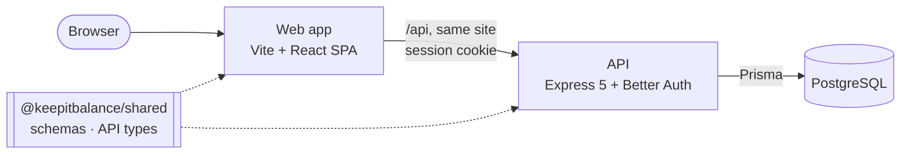

# KeepItBalance

[](https://github.com/kaungmyattun21/keepitbalance/actions/workflows/ci.yml)

> A personal dashboard for keeping money, meals and health in balance: track income and spending,
> plan meals and groceries, and log daily water and calories, in one place.

<!-- Screenshots: login and dashboard, light and dark, at desktop and phone width. -->

**Live demo:** _not deployed yet_

## Status

**Finance and groceries are available locally.** Health and deployment are still planned.

| Milestone | Scope | Status |
|---|---|---|
| 1. Setup + Auth | Project structure, CI, accounts | ✅ Done (real email delivery and Google sign-in still to be configured) |
| 2. Finance | Transactions, grouped budgets, recurring bills, quick logging and monthly summary | Built |
| 3. Groceries & Meals | Ingredients, recipes, pantry, weekly meal plans and shopping generation | Built |
| 4. Shopping → Finance | Finishing a shopping trip records the expense and updates pantry stock | Built |
| 5. Health | Water and calorie goals, daily progress | Planned |

## Features

**Working now**
- Sign up, log in and out with email and password; sessions last 7 days and extend while you use the app
- Password reset and email verification by link (emails print to the API's terminal in development)
- "Continue with Google", enabled when OAuth credentials are configured; the same email links to one account once it's verified
- App shell: sidebar on desktop, bottom navigation on mobile, light/dark/system theme without a flash on load
- Every page you open while logged out sends you to login and back again afterwards

- Income and expense tracking, category groups, budgets, recurring bills and a quick-log keypad
- Recipes with reusable ingredients, servings, instructions, calories per serving and an optional photo
- Private recipe photos stored in PostgreSQL (JPEG, PNG or WebP, up to 2 MB), with preview, replacement and removal
- Meal planning with a weekly overview or a custom start/end date range of up to 31 days; mark meals eaten or planned
- Shopping previews use the selected dates, scale recipe quantities, subtract pantry and list coverage, and add only missing quantities
- Generation preserves checked/priced items and flags excess quantities for review; stale previews must be refreshed
- Finishing shopping updates pantry stock and records one expense against the selected category budget
- Receipt uploads run local English/Thai OCR in a durable background job, with editable review before creating an expense

Marking a meal eaten records its status and calories. Pantry consumption is recorded separately with **Adjust stock**.

**Planned**
- Daily water and calorie goals with progress

## Tech Stack

| Layer    | Choice | Why (one line) |
|----------|--------|----------------|
| Frontend | Vite, React 19, React Router, TanStack Query, Zustand, React Hook Form + Zod, shadcn/ui + Tailwind | Login-gated dashboard: an SPA is the simplest fit |
| Backend  | Express 5, TypeScript, Zod, Better Auth | Separate API with a clear routes → controller → service → repository split |
| Database | PostgreSQL + Prisma | Relational data and all-or-nothing transactions |
| Background jobs | pg-boss + separate Node worker | Durable receipt processing using the existing PostgreSQL database |
| Receipt OCR | Tesseract.js + Sharp | Local text recognition with bundled English/Thai models and bounded image processing |
| Auth     | Better Auth (database sessions, argon2id) | Email/password and Google with safe account linking, without hand-rolled security code |
| Shared   | `@keepitbalance/shared` workspace package | One source of truth for validation rules and API types used by both apps |
| Quality  | Vitest, Testing Library, supertest, ESLint, Prettier, GitHub Actions | Tests against a real database; architecture rules enforced by lint; CI on every push |
| Hosting  | _not chosen yet_ | |

## Architecture

A modular monolith: one web app, one API, one database, with module boundaries enforced in code.



```
frontend/src/                       backend/src/
├── app/       wiring only          ├── app.ts, server.ts   wiring, startup
├── modules/                        ├── modules/
│   ├── shell      layout, theme    │   ├── auth        Better Auth, /me
│   ├── auth       pages, guards    │   ├── finance     transactions, budgets, bills
│   ├── dashboard                   │   └── groceries   recipes, plans, pantry, shopping
│   ├── finance                     └── shared/         config, db, errors, middleware
│   └── groceries
└── shared/    ui, api client       packages/shared/    rules and types used by both apps
```

- **Feature folders:** code lives in `modules/<module>/features/<feature>/` in both apps.
- **One-way module dependencies** (Groceries → Finance → Auth, never the reverse), checked by ESLint
  (`import-x/no-restricted-paths`); other modules import a module only through its `index.ts`.
- **Backend layers:** routes → controller → service → repository; every query is scoped to the logged-in user.
- **Data before render:** React Router loaders fill the TanStack Query cache, so a page's code and data
  load in parallel; route middleware handles authentication before anything renders.
- **Money and dates:** amounts are decimal strings end to end (never floats); calendar days are
  `YYYY-MM-DD` in the user's timezone.

## Getting Started

Requires Node.js 24+, pnpm 9+ and Docker.

```bash
# clone
git clone https://github.com/kaungmyattun21/keepitbalance.git
cd keepitbalance

# install (both apps; pnpm workspace)
pnpm install

# configure
cp .env.example .env                    # Docker: Postgres + pgAdmin logins (used when volumes are first created)
cp backend/.env.example backend/.env    # API: fill in DATABASE_URL and BETTER_AUTH_SECRET

# database
docker compose up -d                    # PostgreSQL on :5432, pgAdmin on :5050
pnpm --filter backend db:migrate        # apply migrations + generate the Prisma client

# run both apps
pnpm dev                                # web: http://localhost:5173 · API: http://localhost:3000/api/v1
```

In development the web app forwards `/api/*` to the API (Vite proxy), so open only <http://localhost:5173>.
Verification and password-reset emails are printed in the API's terminal.

| Command | What it does |
|---|---|
| `pnpm dev` | Start API and web app together |
| `pnpm --filter backend worker:dev` | Start the receipt worker in another terminal |
| `pnpm typecheck` | Type-check both apps |
| `pnpm test` | Run all tests (shared package, frontend, backend) |
| `pnpm lint` | Lint (includes module-boundary rules) |
| `pnpm build` | Build both apps |
| `pnpm format` / `pnpm format:check` | Prettier |

## How receipt background jobs work

Open **Finance → Transactions → Receipts** to upload an image. Start the API/web app with
`pnpm dev` and run `pnpm --filter backend worker:dev` in another terminal. Both processes
use the backend's `DATABASE_URL`; no Redis or cloud OCR credentials are required.
After building, use `pnpm --filter backend start` and `pnpm --filter backend worker:start`.

```text
Browser uploads an image
  → Express validates it with Zod and Sharp
  → Prisma saves the private image and receipt
  → pg-boss saves an extraction job in the SAME database transaction
  → API returns 202 Accepted with the receipt ID

Separate Node worker
  → pg-boss assigns a waiting job
  → Tesseract.js reads English/Thai text with bundled language models and layout information
  → parser suggests merchant, purchase date and total
  → Prisma saves the draft; the job finishes

Browser polls receipt status
  → user reviews or corrects suggestions
  → confirmation saves one categorized expense
  → existing transaction summaries calculate budget spending
```

The API accepts work; the queue remembers work; the worker performs work. Stopping the worker
leaves uploads queued. Restarting it resumes processing. pg-boss creates and maintains its own
`pgboss` schema on first use, while Prisma migrations own the application tables in `public`.
The database role needs permission to create this schema and its objects.

Read the implementation in this order:

1. `backend/src/shared/jobs.ts`: creates the pg-boss client and manages startup/shutdown.
2. `backend/src/modules/finance/features/receipts/queue.ts`: defines retry settings and schedules
   jobs through pg-boss's Prisma transaction adapter. A job contains a receipt ID and version,
   never image bytes.
3. `.../receipts/service.ts`: accepts uploads, reuses identical file hashes for the same user,
   and confirms purchases under a database row lock.
4. `backend/src/worker.ts` and `.../receipts/processor.ts`: start one worker consumer, process
   jobs, save results, and throw on errors so pg-boss can retry.
5. `.../receipts/ocr-provider.ts`: performs bounded image preparation and local OCR.
6. `.../receipts/receipt-parser.ts`: turns recognized text into conservative suggestions.

There are at most three attempts per job, with exponential retry delay. OCR has a two-minute
timeout. Interrupted jobs are recovered by pg-boss; terminal failures allow retry or manual
entry. Repeated jobs reuse completed results; version checks prevent older jobs overwriting
newer attempts. Concurrent confirmation creates only one transaction. Confirmed receipt expenses
can be edited but cannot be deleted independently of their receipt.

The parser supports English/Thai total labels, nearby amount columns, decimal points/commas,
Thai digits, named months, unambiguous numeric dates and Buddhist calendar years. Ambiguous
dates or conflicting totals stay blank. Thai text supplies a day/month hint with a review warning.
Costco/Makro header aliases improve merchant suggestions; generic headings such as Wholesale
are not treated as merchants. Bank transfer slips suggest a recipient rather than the bank,
and warn that an internal transfer must not be saved as an expense. Low OCR confidence also
triggers a warning. These are heuristics requiring human review, not verified document understanding.
Use **Reprocess receipt** on an unconfirmed draft to apply recognition improvements to an existing
upload; this preserves duplicate-file identity and rejects stale worker results. Confirmed receipts
cannot be reprocessed. Reprocessing replaces unsaved form edits.
Line items, pantry updates, and matching different photographs of the same receipt are future work. Exact-file deduplication
uses SHA-256 and only reuses the current user's receipt. Images are stored privately in PostgreSQL
for this first version; moving them to object storage can be a separate change.

## Security notes

- Sessions in `HttpOnly`, `SameSite=Lax` cookies (`Secure` in production); revoked on sign-out and password reset
- Passwords hashed with argon2id; rate-limited sign-in, sign-up and reset requests
- Origin checks against cross-site requests, and redirects only to the app's own origin
- Google accounts link to an existing account only when its email is verified
- Every request validated with Zod; errors never expose internals

### API request limits and reverse proxies

JSON API bodies and all authentication bodies are limited to 100 KiB, including streamed/chunked
requests. Recipe endpoints allow up to 3 MiB to accommodate base64-encoded photos; each decoded
photo is limited to 2 MiB. Receipt endpoints allow 7 MiB JSON bodies for images limited to 5 MiB
and 20 megapixels. Larger bodies return `413`; compressed request bodies are unsupported
and return `415`.

`TRUSTED_PROXIES` defaults to empty: client addresses come from the TCP connection, and client-supplied
forwarded IP/protocol headers are ignored. When deploying behind a proxy, set it to a comma-separated
list of that proxy's IP addresses or CIDRs. For a proxy on the same host, for example:

```dotenv
TRUSTED_PROXIES=127.0.0.1/32,::1/128
```

Configure the proxy to overwrite `X-Forwarded-Proto` and overwrite or safely append to
`X-Forwarded-For`. Restrict access to the API to the intended proxy network. Express resolves the
client from the socket through the trusted chain; Better Auth uses a server-written client-IP header
for sessions and rate limiting. Client-supplied copies of that internal header are overwritten.
Better Auth's production rate-limit counters remain per process; use shared storage before scaling
to multiple API instances. Configure a matching body limit at the proxy as well.

The workspace pins patched transitive versions of `body-parser`, `mysql2`, and Prisma's `deepmerge-ts`
through pnpm overrides. Revisit these overrides when upstream dependencies adopt the patched versions.

## Testing

```bash
pnpm test                              # everything
pnpm --filter frontend test:watch      # frontend, rerun on save
```

- **Frontend:** Vitest + Testing Library (jsdom); the API is mocked at `fetch`.
- **Backend:** Vitest + supertest against a real PostgreSQL database. Tests use `<your database>_test`
  (e.g. `keepitbalance_test`), which is created and migrated automatically on the first run; set
  `TEST_DATABASE_URL` to use a different one. The name must end in `_test`, so your dev data is never touched.
- **CI:** GitHub Actions runs format, lint, typecheck, tests and build on every push to `main` and every pull request.
