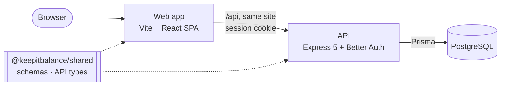

# KeepItBalance

[](https://github.com/kaungmyattun21/keepitbalance/actions/workflows/ci.yml)

> A personal dashboard for keeping money, meals and health in balance: track income and spending,
> plan meals and groceries, and log daily water and calories, in one place.

<!-- Screenshots: login and dashboard, light and dark, at desktop and phone width. -->

**Live demo:** _not deployed yet_

## Status

**Milestone 1 of 5 done: foundation and authentication.** The business modules come next.

| Milestone | Scope | Status |
|---|---|---|
| 1. Setup + Auth | Project structure, CI, accounts | ✅ Done (real email delivery and Google sign-in still to be configured) |
| 2. Finance | Transactions, categories, monthly summary | Next |
| 3. Groceries & Meals | Ingredients, recipes, pantry, meal plans, shopping lists | Planned |
| 4. Shopping → Finance | Finishing a shopping trip records the expense | Planned |
| 5. Health | Water and calorie goals, daily progress | Planned |

## Features

**Working now**
- Sign up, log in and out with email and password; sessions last 7 days and extend while you use the app
- Password reset and email verification by link (emails print to the API's terminal in development)
- "Continue with Google", enabled when OAuth credentials are configured; the same email links to one account once it's verified
- App shell: sidebar on desktop, bottom navigation on mobile, light/dark/system theme without a flash on load
- Every page you open while logged out sends you to login and back again afterwards

**Planned**
- Income and expense tracking with categories and a monthly summary
- Recipes, pantry, weekly meal plans and a generated grocery list
- Finishing a shopping trip updates the pantry and records the expense in one step
- Daily water and calorie goals with progress

## Tech Stack

| Layer    | Choice | Why (one line) |
|----------|--------|----------------|
| Frontend | Vite, React 19, React Router, TanStack Query, Zustand, React Hook Form + Zod, shadcn/ui + Tailwind | Login-gated dashboard: an SPA is the simplest fit |
| Backend  | Express 5, TypeScript, Zod, Better Auth | Separate API with a clear routes → controller → service → repository split |
| Database | PostgreSQL + Prisma | Relational data and all-or-nothing transactions |
| Auth     | Better Auth (database sessions, argon2id) | Email/password and Google with safe account linking, without hand-rolled security code |
| Shared   | `@keepitbalance/shared` workspace package | One source of truth for validation rules and API types used by both apps |
| Quality  | Vitest, Testing Library, supertest, ESLint, Prettier, GitHub Actions | Tests against a real database; architecture rules enforced by lint; CI on every push |
| Hosting  | _not chosen yet_ | |

## Architecture

A modular monolith: one web app, one API, one database, with module boundaries enforced in code.



```
frontend/src/                       backend/src/
├── app/       wiring only          ├── app.ts, server.ts   wiring, startup
├── modules/                        ├── modules/
│   ├── shell      layout, theme    │   ├── auth        Better Auth, /me
│   ├── auth       pages, guards    │   └── finance     categories (more in milestone 2)
│   └── dashboard                   └── shared/         config, db, errors, middleware
└── shared/    ui, api client       packages/shared/    rules and types used by both apps
```

- **Feature folders:** code lives in `modules/<module>/features/<feature>/` in both apps.
- **One-way module dependencies** (Groceries → Finance → Auth, never the reverse), checked by ESLint
  (`import-x/no-restricted-paths`); other modules import a module only through its `index.ts`.
- **Backend layers:** routes → controller → service → repository; every query is scoped to the logged-in user.
- **Data before render:** React Router loaders fill the TanStack Query cache, so a page's code and data
  load in parallel; route middleware handles authentication before anything renders.
- **Money and dates:** amounts are decimal strings end to end (never floats); calendar days are
  `YYYY-MM-DD` in the user's timezone.

## Getting Started

Requires Node.js 24+, pnpm 9+ and Docker.

```bash
# clone
git clone https://github.com/kaungmyattun21/keepitbalance.git
cd keepitbalance

# install (both apps; pnpm workspace)
pnpm install

# configure
cp .env.example .env                    # Docker: Postgres + pgAdmin logins (used when volumes are first created)
cp backend/.env.example backend/.env    # API: fill in DATABASE_URL and BETTER_AUTH_SECRET

# database
docker compose up -d                    # PostgreSQL on :5432, pgAdmin on :5050
pnpm --filter backend db:migrate        # apply migrations + generate the Prisma client

# run both apps
pnpm dev                                # web: http://localhost:5173 · API: http://localhost:3000/api/v1
```

In development the web app forwards `/api/*` to the API (Vite proxy), so open only <http://localhost:5173>.
Verification and password-reset emails are printed in the API's terminal.

| Command | What it does |
|---|---|
| `pnpm dev` | Start API and web app together |
| `pnpm typecheck` | Type-check both apps |
| `pnpm test` | Run all tests (shared package, frontend, backend) |
| `pnpm lint` | Lint (includes module-boundary rules) |
| `pnpm build` | Build both apps |
| `pnpm format` / `pnpm format:check` | Prettier |

## Security notes

- Sessions in `HttpOnly`, `SameSite=Lax` cookies (`Secure` in production); revoked on sign-out and password reset
- Passwords hashed with argon2id; rate-limited sign-in, sign-up and reset requests
- Origin checks against cross-site requests, and redirects only to the app's own origin
- Google accounts link to an existing account only when its email is verified
- Every request validated with Zod; errors never expose internals

### API request limits and reverse proxies

JSON API bodies and all authentication bodies are limited to 100 KiB, including streamed/chunked
requests. Larger bodies return `413`; compressed request bodies are unsupported and return `415`.

`TRUSTED_PROXIES` defaults to empty: client addresses come from the TCP connection, and client-supplied
forwarded IP/protocol headers are ignored. When deploying behind a proxy, set it to a comma-separated
list of that proxy's IP addresses or CIDRs. For a proxy on the same host, for example:

```dotenv
TRUSTED_PROXIES=127.0.0.1/32,::1/128
```

Configure the proxy to overwrite `X-Forwarded-Proto` and overwrite or safely append to
`X-Forwarded-For`. Restrict access to the API to the intended proxy network. Express resolves the
client from the socket through the trusted chain; Better Auth uses a server-written client-IP header
for sessions and rate limiting. Client-supplied copies of that internal header are overwritten.
Better Auth's production rate-limit counters remain per process; use shared storage before scaling
to multiple API instances. Configure a matching body limit at the proxy as well.

The workspace pins patched transitive versions of `body-parser`, `mysql2`, and Prisma's `deepmerge-ts`
through pnpm overrides. Revisit these overrides when upstream dependencies adopt the patched versions.

## Testing

```bash
pnpm test                              # everything
pnpm --filter frontend test:watch      # frontend, rerun on save
```

- **Frontend:** Vitest + Testing Library (jsdom); the API is mocked at `fetch`.
- **Backend:** Vitest + supertest against a real PostgreSQL database. Tests use `<your database>_test`
  (e.g. `keepitbalance_test`), which is created and migrated automatically on the first run; set
  `TEST_DATABASE_URL` to use a different one. The name must end in `_test`, so your dev data is never touched.
- **CI:** GitHub Actions runs format, lint, typecheck, tests and build on every push to `main` and every pull request.
